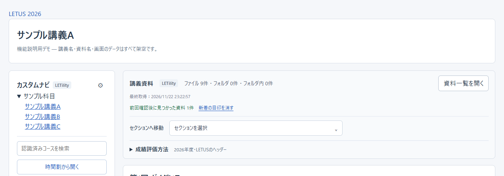
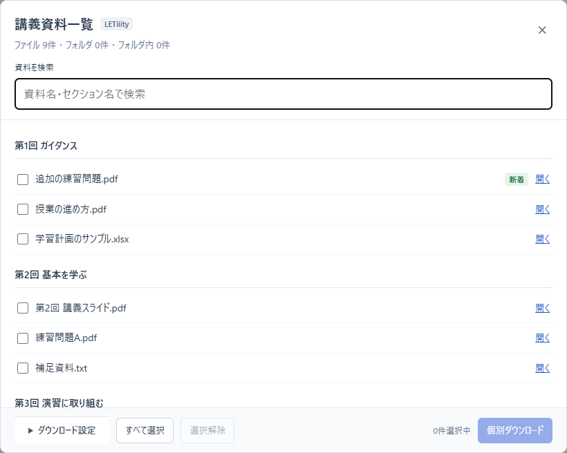
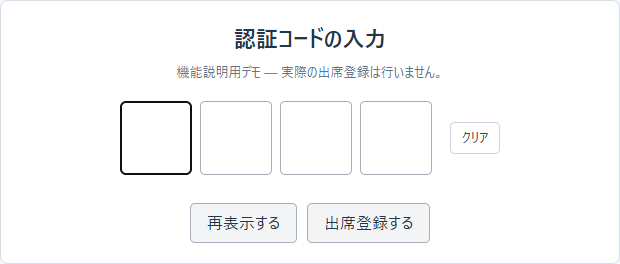

# LETility（大学非公式）

LETUS・CLASSの閲覧、講義資料の保存、提出ファイルの確認を補助するChrome拡張機能です。

LETilityは大学非公式の拡張機能です。東京理科大学および各システムの提供者による提供・承認を示すものではありません。

[機能一覧・使い方](https://onzzuniv.github.io/letility-privacy/guide.html) · [プライバシーポリシー](https://onzzuniv.github.io/letility-privacy/)

## 配布について

0.1.0はChromeウェブストアで限定公開されています。0.1.1は一般公開に向けて準備中です。「0.1.1以降」と記載した機能は、新版の承認・公開後に利用できます。ストアURLは公開後にこのページで案内します。

## 機能一覧

- **カスタムナビ**：LETUSの講義へのリンクを、名前を付けたグループに整理できます。講義の追加、並べ替え、グループ間の移動に対応します。
- **認識済みコース検索（0.1.1以降）**：カスタムナビ下部から、認識済みのコース全体を講義名・科目コードで検索できます。ナビ未登録のコースも結果から直接開けます。通常のナビの表示は変わりません。
- **CLASS時間割からのプリセット**：CLASSで表示した学生時間割表をもとに、LETUSのナビ編集で年度・学期別や曜日別の講義グループを作れます。
- **時間割からコースを開く（0.1.1以降）**：保存済みのCLASS時間割を曜日・時限で表示し、科目名からLETUSコースへ移動できます。年度・学期の切り替え、未取得時のCLASSへの案内に対応します。
- **シラバスの成績評価方法（0.1.1以降）**：講義ページ上部で成績評価方法の原文を確認できます。年度の切り替え、合同コースのコード別表示、元シラバスへのリンクに対応します。
- **セクションジャンプと前回の位置**：講義のセクションを検索して移動できます。講義ごとに最後に開いたセクションを記録し、次回は「前回：○○へ」ボタンから戻れます。
- **ページの先頭へ戻る（0.1.1以降）**：長い講義ページを下へスクロールすると、右下に先頭へ戻るボタンが表示されます。先頭付近では隠れます。
- **講義資料一覧と検索**：講義ページの資料とフォルダ内のファイルをまとめて確認し、資料名・セクション名で絞り込めます。
- **資料の新着目印**：前回確認後に新しく見つかった資料へ「新着」の目印を付けます。講義ページと資料一覧に表示し、講義ごとにまとめて消せます。初回は比較の基準を作ります。
- **個別・まとめてダウンロード**：資料の横の保存ボタンや資料一覧から保存できます。選択した資料の個別保存とZIP保存、ZIP内のセクション別フォルダ分けに対応します。
- **提出ファイルの簡易プレビュー**：課題ページの提出済み・アップロード済みファイルを確認できます。PDF、画像、テキスト・CSV、DOCX、XLS・XLSX、PPTX、ZIP内の項目一覧、対応する音声・動画を表示します。
- **CLASSの出席コード入力補助**：4桁の入力欄で、全角数字の補正、4桁の貼り付け、Backspaceでの入力修正、クリアボタンを使えます。CLASSが学外ネットワークと表示している場合には、登録前に確認を出します。
- **アンケート記述欄の拡大編集**：LETUSのアンケート（Feedback）の記述欄を、大きな編集画面で折り返し表示できます。文字数を確認しながら編集し、元の回答欄に反映できます。
- **初回の説明と保存データの管理**：LETUSまたはCLASSを初めて開くと、データの扱いを説明します。同意は同じChromeプロファイル内で共有され、拡張機能のアイコンから説明の確認と保存データの削除ができます。

## 使い方

掲載画像は、架空の講義名・資料名を使った機能説明用デモです。大学画面の背景は説明用に簡略化し、LETilityの追加機能は本体を動かして撮影しています。

### 導入と初回の確認

1. 開発版を使う場合は、受け取ったZIPを解凍し、manifest.jsonが入ったフォルダを確認します。
2. Chromeの「拡張機能を管理」でデベロッパーモードを有効にし、「パッケージ化されていない拡張機能を読み込む」からそのフォルダを選びます。
3. LETUSまたはCLASSに通常どおりログインし、初回の説明を読みます。データの扱いに同意すると補助機能が始まります。
4. 辞退した場合は、拡張機能のアイコンから説明を読み直して同意できます。

### 講義をカスタムナビに整理する

1. LETUSの「カスタムナビ」にある編集ボタンを開きます。LETilityの小さな表示が目印です。
2. グループを作り、画面に読み込まれた講義を選んで追加します。必要に応じて名前や順序を変更し、「変更を保存」を押します。
3. 時間割から作る場合は、CLASSにログイン後、画面上部の「履修」→「学生時間割表」を開きます。0.1.1以降はプリセット内の「CLASSを開く」から開いたタブに手順の案内が出て、保存完了時に約5秒間通知します。LETUSへ戻って「プリセットから追加」を開き直し、年度・学期と分類方法を選びます。
4. 対応する講義が見つからない場合は、LETUS側の講義一覧を確認してから手動で追加してください。

講義トップのデモ：カスタムナビと資料・セクションへの入口。

### 時間割から講義を開く（0.1.1以降）

1. カスタムナビ下部の「時間割から開く」を押します。
2. 年度・学期は日本時間の日付から仮選択します。必要に応じて切り替えてください。
3. データがない場合は「CLASSを開く」を押し、ログイン後に画面上部の「履修」→「学生時間割表」を開きます。CLASS上に操作案内が出て、保存完了後に「時間割表を読み込みました」と約5秒間表示します。元のダイアログを開いていれば取得結果が反映されます。
4. 科目名を押すと対応するLETUSコースが開きます。候補が複数なら選択し、未一致の科目からは誤ったコースを自動で開きません。
5. 通常の時間割を表示する機能で、休講・補講は反映しません。狭い画面では表を横にスクロールできます。

### 成績評価方法を確認する（0.1.1以降）

1. 講義ページ上部の講義資料カードで「成績評価方法」を開くと、CLASSの公開シラバスを取得します。閉じている間は取得しません。
2. 年度はLETUSのヘッダーから初期選択します。ヘッダーが不明なら現在年度を推定し、その旨を表示します。必要に応じて年度を変更できます。手動の選択は講義ごとに記憶します。
3. 合同コースは授業コードごとに表示します。取得した年度・コードが一致しなかった場合や未記載・404ではその旨を表示し、別年度に自動で切り替えません。
4. 元のシラバスを開くリンクから全文を確認できます。表示するのはシラバスの記載なので、授業中やLETUSでの最新の案内も確認してください。本文は拡張機能の保存領域へ保存しません。

### セクションへ移動・前回の位置へ戻る

1. 講義トップの「セクションへ移動」からセクションを選びます。検索欄でも絞り込めます。
2. 次回は「前回：○○へ」を押すと、最後に開いたセクションへ移動します。閉じた見出しは展開します。
3. ジャンプで選んだ、見出しを展開した、または中の資料リンクを開いたときに記録します。初期表示やスクロールだけでは更新しません。前回のセクションが現在のページにない場合、ボタンは表示されません。

### 講義資料を探して保存する

1. 講義トップで「資料一覧を開く」を押し、資料名やセクション名で検索します。
2. 必要な資料にチェックを付け、「ダウンロード設定」で個別保存・ZIP保存などを選び、ダウンロードします。資料の横の保存ボタンから個別に保存することもできます。
3. 利用制限のある資料は大学側の条件に従います。ログイン切れなどで保存できない場合は、LETUSにログインし直してから再度開いてください。

資料一覧のデモ：資料名で検索し、必要なファイルを選んで保存できます。

### 前回確認後に見つかった資料を確認する

1. 講義ページを初めて表示した際に、資料一覧を比較の基準として記録します。この時点で既存の資料をすべて新着にすることはありません。
2. 次に講義ページを表示・再読み込みすると、新しく見つかった資料の横と資料一覧に「新着」が付きます。フォルダ内で新しく見つかったファイルも対象です。
3. 確認を終えたら「新着の目印を消す」で、その講義の目印をまとめて消せます。資料を開いたかどうかを示す既読・未読表示ではありません。
4. 目印は実際のアップロード日時を示しません。初めて正常に読み取れた既存フォルダや、保存データ削除・30日を超える未利用などで比較の基準がなくなった場合は、再度基準を作ります。

### 提出ファイルを確認する

1. LETUSの課題ページで、対応する提出済み・アップロード済みファイルのプレビューボタンを押します。
2. 表示内容を確認し、「閉じる」で終了します。元のファイルが必要な場合はダウンロードします。
3. Officeファイルは内容確認用の簡易表示です。元のレイアウトを完全には再現しません。ZIPは内部の項目一覧を表示します。提出の確定やファイルの削除はLETUSの通常画面で行ってください。

### CLASSの出席コードを入力する

1. CLASSの出席登録画面で、授業で案内された4桁のコードを入力します。4桁まとめて貼り付けることもできます。
2. 入力し直すときはBackspaceや「クリア」を使います。登録はCLASSの通常の登録ボタンで行い、結果もCLASS上で確認してください。
3. 学外ネットワークの確認が出た場合は、CLASSの表示と接続状況を確認して操作を選びます。出席条件は授業・大学の案内に従ってください。

出席入力補助のデモ：4桁の入力欄をまとめてクリアできます。

### アンケートの文章を広い欄で編集する

1. LETUSのアンケート回答画面で、記述欄の下にある「拡大して入力」を押します。
2. 大きな編集欄で文章を読み直し、修正します。文字数と、元の回答欄に設定された上限を表示します。上限の指定がない欄には、拡張機能独自の上限を追加しません。送信時のLETUS側のチェックはそのままです。
3. 「反映して閉じる」で元の回答欄に戻します。キャンセルした場合は元の回答を変更しません。元が1行の入力欄であれば、改行はスペースに変換します。
4. 回答の送信はLETUSの通常の送信ボタンから行ってください。拡大画面で編集しただけでは送信されず、入力内容を拡張機能の保存領域へ保存することもありません。

### 説明の再確認・保存データの削除

1. 拡張機能のアイコンから設定画面を開きます。プライバシーポリシーもここから読めます。
2. 「保存データを削除」で、ナビ設定・履修情報・資料情報・前回のセクションなどを消去できます。同意の記録は残ります。大学側のデータやダウンロード済みのファイルは消えません。
3. 同じChromeプロファイルでは大学アカウント1つでの利用を想定しています。アカウントを切り替える場合は、保存データを削除してください。

### 更新後に機能が出ない・表示できないとき

1. 入力中の内容を保存してから、拡張機能を更新し、LETUS・CLASSのタブも再読み込みしてください。開いたままのタブには更新前の処理が残る場合があります。
2. プレビューには容量・表示件数の制限があります。Office・ZIPは20MB、その他の対応形式は80MBまでが目安です。複雑なファイルや未対応形式は元のファイルで確認してください。
3. 大学側の画面変更やブラウザ、ファイル形式によって、補助機能が使えない場合があります。必要に応じて拡張機能を無効にし、大学サイトの通常の操作で確認してください。

## データの扱い

講義・履修情報、資料情報、設定、前回のセクションは、このChromeプロファイル内に保存します。提出ファイルはプレビュー時にLETUSから取得し、ブラウザ内で解析します。開発者への送信、広告、アクセス解析は行いません。詳しい保存項目・期間・削除方法はプライバシーポリシーをご確認ください。 成績評価方法を開くと、CLASSの公開シラバスをログイン情報なしで取得します。手動で変更したシラバス年度は講義ごとに保存し、本文は永続保存しません。

[プライバシーポリシー全文](https://onzzuniv.github.io/letility-privacy/)

## このリポジトリについて

利用者向け説明の公開用です。公開対象は、ポリシーのindex.html、機能一覧・使い方のguide.html、このREADME.md、静的配信用の.nojekyllと、架空データによるデモ画像3枚です。
